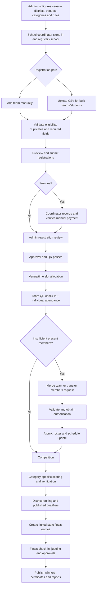

# EIRO Robotics Competition Management Platform

**Developer-ready product requirements, workflows, data model and implementation blueprint**  
**Organization:** Evolve Robotics  
**Version:** 1.1 (manual payment verification + two-day training attendance)  
**Database and backend platform:** Firebase (Cloud Firestore, Firebase Authentication, Cloud Functions, Cloud Storage)  
**Client:** Responsive web app / progressive web app (PWA)

> **Instructions for AI coding agents:** Implement this as a production-oriented, maintainable application. Treat everything explicitly marked **proposed**, **example**, or **configurable** as a default requiring administrator sign-off; do not present it as an official approved EIRO rule. Build in phases. Do not silently invent eligibility rules, qualifying quotas, payments, or scoring parameters. Provide Firebase security rules, indexes, automated tests, migrations/seeding, emulator setup, deployment instructions, and a usable interface.

## 1. Product purpose

Create one central system for EIRO robotics events from school registration through district preliminaries and state finals. Replace fragmented spreadsheets, messaging, manual check-ins and scoring with secure, auditable workflows.

### Confirmed decisions

- Event structure: **District Preliminaries → State Finals**.
- Team registration performed by **school coordinators**, with individual entry and **bulk CSV upload**.
- Competition categories (seven):
  1. **Sumo Wrestling** (`SUMO`)
  2. **Maze Solver** (`MAZE`)
  3. **Wall Following** (`WALL`)
  4. **Eco City — Smart Waste Management System** (`ECO_CITY`)
  5. **NextGen Factory — Industrial Automation Challenge** (`NEXTGEN_FACTORY`)
  6. **Young Innovator Junior** (`INNOVATOR_JUNIOR`)
  7. **Young Innovator Senior** (`INNOVATOR_SENIOR`)
- Mixed scoring engine depending on competition type.
- Both free and paid events/entries supported; fee rules configurable by category and stage. **No payment gateway:** authorized Event Coordinators manually verify payments with an audit trail.
- Two-day training program: **individual student attendance for Day 1 and Day 2** with separate training attendance reports.
- Team adjustments in response to absences: **team merge** and **individual member transfer**, subject to authorization and eligibility checks.
- Administrative policies have reportedly been defined (team sizes, grades, matches and attempts, qualifiers, judge counts, fees, appeals), but **actual numeric values are not supplied**. Store them as editable configuration; do not hardcode guessed values.

## 2. Roles and scoped permissions

| Role | Capabilities |
|---|---|
| Super Admin | Manage all seasons, categories, districts, schools, registrations, manually verified payments, staff, judging, results and rule versions. |
| District Admin | Approve and manage assigned district events, requests and results within authorized scope. |
| Venue Coordinator | Venue allocations, time slots, training and competition attendance, authorized manual payment verification, merge/transfer requests, arena monitoring. |
| School Coordinator | Manage permitted school's profile and rosters, manually/bulk register teams, see status, view payment verification status, passes and results. |
| Judge / Referee | Access assigned matches/runs/scorecards, submit and inspect permitted evaluations. |
| Head Judge | Verify scores, resolve scoring disputes, approve or reopen scores with reason. |
| Check-in Volunteer | Verify team QR passes and record individual attendance for assigned events. |
| Public Viewer | View **published-only** schedules/results/rules and verify certificates with privacy-respecting data. |

- An account may have multiple role assignments, always tied to specific scopes (season, district, event, school, category, venue).
- Enforce access controls **in Firestore Security Rules and trusted Cloud Functions**, never in client UI alone.
- Sensitive actions (payment verification, merge approval, score lock, qualification and publication) must only run in trusted backend code after checking permissions.

## 3. High-level workflow



## 4. User interface screens

### 4.1 Super Admin and District Admin

| ID | Screen | Main controls / behavior |
|---|---|---|
| A01 | Admin sign-in | Auth, password recovery, optional MFA. |
| A02 | Competition overview | KPI cards, district/category/stage filters, approvals, alerts, participation and financial summaries. |
| A03 | Season creation | Year/name, registration window, stages, status, rule version and publishing. |
| A04 | Category and rules configuration | All seven categories, grade limits, team limits, technical specifications, fee and scoring templates by stage. |
| A05 | District and venue management | Districts, venues, capacity, arena/station allocations, time windows. |
| A06 | School/team approvals | Review documents, payment/eligibility, approve, reject, or request correction. |
| A07 | Schedule builder | Slots, judges, teams, rooms/arenas; detect clashes before publishing. |
| A08 | Staff and judging assignments | Invite and scope judges, check-in staff, head judges and coordinators. |
| A09 | Live operations | Attendance, queues, current matches, runs, missing scores, delays. |
| A10 | Score verification | Review original judge scores, run details, protests, audit history, lock/reopen. |
| A11 | Rankings and qualification | Tie breakers, quotas, provisional and final rankings, qualification approval. |
| A12 | State finals management | Finals entries, confirmation, optional fee, schedule and judging. |
| A13 | Publication and certificates | Publish results, issue/revoke/reissue verifiable PDFs. |
| A14 | Reports and audit history | CSV/PDF exports, registration, attendance, payments, score changes. |
| A15 | Team adjustment approvals | Review proposed merge/transfers and warnings; approve/reject/request revision. |
| A16 | Team adjustment history | Source/target rosters and stage entries, reasons, permissions, approvals and immutable snapshots. |
| A17 | Bulk import monitoring | Imports, validation failures, job statuses, imported counts, correction/retry history. |

### 4.2 School Coordinator

| ID | Screen | Main controls / behavior |
|---|---|---|
| S01 | Sign-up/login | Email/phone as supported; verified coordinator account. |
| S02 | School profile | School contact/address, district, official contact and validation. |
| S03 | Dashboard | Team counts and status, tasks, payments, passes, district/finals notices. |
| S04 | Category directory | Filter categories and inspect rules/fees and availability. |
| S05 | Manual team registration | Team name, category, members, grades, project and required uploads. |
| S05B | **Bulk CSV registration** | Download template, upload, map columns, validate, preview teams, fix errors and submit. |
| S06 | Review and submit | Required fields, eligibility, duplicate checks, confirmation and submission. |
| S07 | Fee status | View due amount, payment instructions, manual verification status and recorded receipt; no online checkout. |
| S08 | Registration tracker | Draft, submitted, review, correction required, approved/rejected/withdrawn. |
| S09 | Team passes | QR and team ID, approved event, reporting details. |
| S10 | Schedule and venue | Map/address, reporting time, arena, schedule, announcements. |
| S11 | District results and finals | Published rank, qualification and finals confirmation. |
| S12 | Certificates | Downloads only for own school teams and authorized students. |
| S13 | Member transfer / team merge request | Select source/target, present students, reason, review and approval status. |

### 4.3 Judges/Referees

- J01: Secure judge sign-in.
- J02: Assigned categories, venues, rounds and participants.
- J03: Team/robot eligibility and readiness check.
- J04: Rubric scorecard (criteria/comments) **or** timer/checkpoint **or** sumo match controls.
- J05: Stopwatch and match controls: precise times, events, penalties, outcomes.
- J06: Preview totals and obtain judge confirmation.
- J07: Submit score (server-validated, timestamped, immutable after submission unless approved correction).
- J08: View own scorecard history and approved correction requests.

### 4.4 Venue and public

- V01: Venue coordinator/check-in staff sign-in.
- V02: Scan QR or manually search permitted Team ID.
- V03: View eligible team details (minimal necessary student data).
- V04: **Individual student attendance**: present, absent, not yet reported; timestamp and actor.
- V05: Arena queue and live participant readiness.
- V06: Venue status and incident reporting.
- V07: Attendance and eligibility alerts.
- V08: Initiate merge/transfer request with coordinator acknowledgement.
- V09: **Manual payment verification** (authorized Event Coordinator): list pending fees, find school/team, enter method (CASH / BANK_TRANSFER / UPI / OTHER), amount received, receipt/reference number, optional proof attachment, notes and mark VERIFIED / PARTIAL / REJECTED. Prevent duplicate confirmations, log verification actor/time.
- V10: **Training Day 1 attendance**: select training event/session, load registered teams and individual students, mark PRESENT / ABSENT / NOT_MARKED, submit with actor/time.
- V11: **Training Day 2 attendance**: independent student attendance records and summary, with ability to compare Day 1.
- V12: **Training attendance dashboard**: day-wise student totals, per-team status, absent list, both-days-present counts, filter/export CSV.
- V13: **Attendance correction**: authorized staff adjust mistaken marks with reason and immutable change history.
- P01: Public event landing page, announcements and published rules.
- P02: Public published schedules/results and category standings.
- P03: Certificate verification page, exposing only minimal authorized metadata.

## 5. School registration workflows

### 5.1 Manual registration

1. School coordinator authenticates and completes/chooses a verified school profile.
2. Selects active season, district and category.
3. Adds team metadata, individual students and project details where applicable.
4. Backend validates category-specific grade/team-size rules and duplicate eligibility restrictions.
5. School submits team; fee rules generate amount due / invoice if applicable.
6. If fees apply, authorized Event Coordinator records and verifies the manually received payment (or admin approves waiver); server checks verified status and admin reviews registration.
7. Approved team receives Team ID and a signed/opaque QR pass, plus venue/schedule when assigned.
8. School sees real-time status and correction requests.

### 5.2 Bulk CSV import (essential)

**UI flow:** School Dashboard → Register Teams → Bulk CSV Upload → Download Template → Select CSV → Column Mapping (optional) → Validate → Preview Teams/Errors → Resolve → Confirm Import → Submit Registration(s).

**Template columns (example):**

```csv
team_reference,team_name,category_code,student_name,grade,section,project_title,coordinator_name,coordinator_phone
T001,Robo Warriors,SUMO,Student One,7,A,,Teacher One,9876543210
T001,Robo Warriors,SUMO,Student Two,7,A,,Teacher One,9876543210
T002,Eco Innovators,ECO_CITY,Student Three,8,B,Smart Waste Bin,Teacher One,9876543210
```

**CSV design:**

- One row per student. All rows with same `team_reference` inside one school and import are grouped into a team; avoid grouping exclusively by display name.
- School and season determined from authenticated coordinator and selection, **not accepted blindly from CSV**.
- Downloadable template with allowed category codes and examples. Accept UTF-8 CSV; safely normalize whitespace and encodings.
- Validate required columns, blank values, grades, team size, category, duplicate student/roster entries, repeated team references, forbidden combination of categories, and stage-appropriate rules.
- Flag both within-file duplicates and existing-database conflicts.
- Preview valid/invalid rows, per-team totals and row-level error explanations.
- Offer downloadable error CSV with row number and error codes. Permit re-upload and revalidation.
- No permanent team writes on upload alone. Commit only after coordinator confirmation.
- Imports should be idempotent: assign `importJobId`, deterministic row/group keys and a server-side deduplication strategy; retries must not duplicate teams.
- For larger files, process in background Cloud Functions/Cloud Tasks queues, mindful of Firestore batch/transaction/write limits. Use chunked commits and resumable progress; never imply all-or-nothing across an arbitrarily large import without explicit staging semantics.
- Generate Team IDs for committed registrations; preserve import provenance and audit records.
- For paid entries, generate an amount due/invoice; school users cannot mark payment verified. Only a scoped Event Coordinator or Admin can verify manually received payments via a trusted Cloud Function with an audit log.
- Security: file size and row-count quotas, storage scan/validation, CSV formula-injection escaping on exported error files, rate limiting, and permission checks.

**Import status:** `UPLOADED → VALIDATING → NEEDS_CORRECTION | VALIDATED → COMMITTING → COMPLETED | PARTIAL_FAILED`. Support reprocessing rejected groups without duplicate successful groups.

## 6. Team attendance, merging and member transfer

**Reason:** On competition day, some registered students may be absent. The system must allow organizers to transfer present members or combine compatible teams when published EIRO rules permit.

### 6.1 Flow

1. Check-in verifies the team and records **individual student attendance** for the specific event/stage.
2. System compares present roster with the category's configured minimum team size.
3. If short-staffed, authorized coordinator creates adjustment request: **MERGE_TEAMS** or **TRANSFER_MEMBERS**.
4. Select source/target teams, students moving, adjustment reason and coordinator acknowledgement.
5. Backend checks category, division/grade, stage, district/venue, eligibility, head count, presence, and competition start status.
6. District Admin or Super Admin reviews warnings and authorizes or rejects. Cross-school merges must be denied by default unless a published rule specifically allows them and all needed permissions/consents are satisfied.
7. Approval executes an **atomic Firestore transaction where feasible** on canonical active-roster and stage-entry documents; record a versioned before/after snapshot, actor, timestamps and reason. For changes spanning more writes than a transaction permits, use a guarded workflow/saga with reserved state, compensating steps, and no partially active team.
8. Update resulting stage-entry roster, active status, pass and *future* schedules. Preserve original school/team registration records and history.
9. Notify affected school coordinator(s), judges and venue staff of authorized changes.
10. A later-arriving absent member does not automatically revert an approved adjustment; a new approved correction is needed.

### 6.2 Mandatory safeguards

- Source and target teams normally same category, division, stage and event.
- Combined/remaining teams must meet minimum and maximum approved size and all student eligibility rules.
- Transfer only present, checked-in students in a supported competition-day merge scenario.
- Block by default once either team has begun judging, match or timed run; override only if formally allowed and audited.
- Do not merge teams from different stages or silently merge independently qualified finals entries.
- Handle fees and qualification attribution according to published rules; do not automatically carry scores or awards to a newly combined team.
- For a full merge, retain target/primary Team ID and mark source **stage entry** as `MERGED`; preserve original team identity and historical membership.
- For a partial transfer, both entries may remain active **only if both remain eligible**.
- Enforce optimistic concurrency/version checks: simultaneous approvals and check-ins cannot corrupt memberships.

**Request statuses:** `DRAFT, PENDING_ACKNOWLEDGEMENT, PENDING_REVIEW, APPROVED, REJECTED, CANCELLED, APPLIED, FAILED_REQUIRES_REVIEW`.

## 7. Event scheduling and check-in

- Admin creates venues, arenas, stations and event sessions for districts and finals.
- Scheduler assigns approved teams; prevent collisions for the same team, judge, arena or constrained resources.
- Display assigned reporting time and dynamically refreshed status; preserve revision history for published changes.
- QR pass must reference a server-verified registration/stage-entry ID; do not place sensitive student details inside QR contents.
- At check-in, scan code; verify current status, venue and eligibility; capture per-student presence.
- Correcting attendance requires scope-appropriate permission and an audit record.
- Support controlled offline caching where feasible: clearly mark pending offline check-ins and synchronize with conflict management.

## 8. Competition scoring rules and engines

**Important:** The numeric values and detailed technical measurements below are **illustrative draft defaults**, not signed-off EIRO standards. The app must load a **published versioned rule configuration** for each season, stage and category.

### 8.1 Engine mapping

| Category | Engine | Main inputs |
|---|---|---|
| Sumo Wrestling | Match/tournament | Bouts, winner, penalties, DQ, bracket status. |
| Maze Solver | Timed/technical | Completion, checkpoints, elapsed milliseconds, penalties, attempts. |
| Wall Following | Timed/technical | Completion, checkpoints, wall tracking, elapsed milliseconds, penalties. |
| Eco City | Judged rubric | Innovation, implementation, functional demonstration, impact, presentation. |
| NextGen Factory | Hybrid tasks + rubric | Successful cycles, accuracy, safety, engineering, reliability, presentation. |
| Young Innovator Junior | Judged rubric | Creativity, functionality, problem understanding, usefulness, presentation. |
| Young Innovator Senior | Judged rubric | Innovation, engineering depth, functionality, impact, documentation. |

### 8.2 Sumo Wrestling

- Autonomous robot vs robot on prescribed arena.
- Record matches, bouts, outcomes, forfeits, penalties, disqualifications and referees.
- Bracket format, number of bouts, draw/replay rules, start positions, dimensions, weight, battery/sensor rules and robot inspections come from official season category configuration.
- Prohibit dangerous weapons, sharp projecting mechanisms, flames, projectiles and harmful interference.
- Winner selection and next-round progression must be verified on server; match results cannot be altered silently.
- UI: opponent cards, countdown/match timer, bout state, penalties, decision confirmation, bracket view.

### 8.3 Maze Solver

- Autonomous course navigation with prescribed start/finish and checkpoints.
- Record attempts, raw time, checkpoint progress, completion, violations, penalties and adjusted time.
- Suggested illustrative 100-point rubric: destination 50, progress/checkpoints 30, navigation accuracy 20.
- Ranking policy configurable: best valid adjusted time, or highest technical score then time; do not blend incompatible ranking methods inadvertently.
- Publish maze size, wall/cell specification, robot dimensions, testing rules and sensor constraints.

### 8.4 Wall Following

- Autonomous following of assigned wall side and prescribed course.
- Record time, checkpoints, collisions, deviation and other violations.
- Suggested illustrative 100-point rubric: route completion 50, checkpoints 30, wall-following accuracy 20.
- Ranking and penalties as a published configurable policy; attempts/time limits and tie-breaks from approved rules.

### 8.5 Eco City — Smart Waste Management System

**Suggested rubric (100):** innovation 20; technical implementation 25; working prototype 25; environmental/practical impact 20; presentation 10.

Require explanation of the waste problem, demonstrated solution and team contribution. Prohibit bringing hazardous actual waste. Record rubric item score and judge comment independently.

### 8.6 NextGen Factory — Industrial Automation Challenge

**Suggested rubric (100):** successful automation cycles 30; sensing/sorting accuracy 20; safety 10; technical design/programming 20; reliability/error handling 10; presentation 10.

Example task: item detection → classification → actuation/routing → error reporting → emergency stop. Each cycle should have auditable success/error data. Prefer low-voltage model equipment; any hazardous equipment needs event safety approval.

### 8.7 Young Innovator Junior

**Suggested rubric (100):** creativity 30; working model 25; problem understanding 20; usefulness 15; presentation 10. Judge age-appropriate ownership and comprehension.

### 8.8 Young Innovator Senior

**Suggested rubric (100):** innovation 20; engineering/technical depth 30; prototype function 25; practical impact 15; documentation/presentation 10. Request problem statement, architecture, implementation, tests, limits and student contributions.

### 8.9 Cross-category score lifecycle

`DRAFT → SUBMITTED → UNDER_REVIEW → VERIFIED → LOCKED → PUBLISHED`.

- Independent judge entries; aggregate using administrator-configured method (average, weighted, sum, match score, best valid attempt, etc.).
- Validation and authoritative score calculations in Cloud Functions.
- Head Judge can request reopening/correction with mandatory rationale and audit trail.
- Immutable versioned snapshots for locked and published results; no direct client modifications.
- Tie breakers, appeals and disqualification rules configurable by category/stage.

## 9. District results and state finals

1. Lock all relevant district-category results after score verification and approved disputes.
2. Compute ranks using published category ranking policy and tie-breakers.
3. Apply approved qualifying quota **by district/category (and division if applicable)**.
4. Show a provisional qualifier preview to authorized administrators.
5. Authorized admin approves qualification snapshot; publish district results and qualifiers.
6. Create linked finals **stage entries** for the same existing teams; do not create duplicate team identities.
7. School confirms attendance; finals fee if applicable is verified.
8. Schedule finals, check in individual members, conduct scoring under finals-specific rule version.
9. Publish approved state rankings, awards and verifiable certificates.

**Rule:** Do not automatically carry preliminary scores into finals unless official competition configuration expressly authorizes it. Treat combined/merged teams at finals as a separately governed exception, not a routine merge.

## 10. Firestore data model (not SQL)

Use Firebase Authentication `uid` as the user principal, Firestore document IDs as internal identifiers, and human-readable team codes as immutable **display IDs**. Use `serverTimestamp()` for authoritative timestamps. Keep document payloads bounded; avoid giant arrays of mutable participant IDs. Denormalize *read-only summaries* for dashboards and use Cloud Functions for canonical writes, aggregation and authoritative recalculations.

### 10.1 Suggested top-level collections

| Collection | Key document fields / notes |
|---|---|
| `users/{uid}` | displayName, email, phone, state; public profile only as authorized. |
| `roleAssignments/{id}` | uid, role, scopeType, scopeId, createdBy, active. |
| `schools/{schoolId}` | schoolCode, name, districtId, address, coordinators summary, verificationStatus. |
| `students/{studentId}` | schoolId, name, grade, optional section, consent metadata, private fields. |
| `seasons/{seasonId}` | year, name, registration windows, phase, published settings. |
| `categories/{categoryCode}` | official display name, engine type and metadata. |
| `seasonCategories/{id}` | seasonId, categoryCode, enabled, team limits, grade/division rules, fee config references. |
| `ruleVersions/{id}` | seasonId, stageType, categoryCode, version, status, immutable published rules, scoring schema. |
| `districts/{districtId}` | name and supported event metadata. |
| `venues/{venueId}` | name, districtId, address, capacity and facilities. |
| `events/{eventId}` | seasonId, stageType, categoryCode, districtId (null for state-wide finals if appropriate), venueId, state. |
| `arenas/{arenaId}` | venueId, identifier, type and status. |
| `teams/{teamId}` | seasonId, schoolId, categoryCode, displayTeamCode, teamName, optional projectTitle, createdBy. |
| `teamMemberships/{membershipId}` | teamId, studentId, validFrom, validTo, sourceAdjustmentId, role/status; maintain history. |
| `registrations/{registrationId}` | teamId, seasonId, state, eligibility snapshot, fee status, approval actor. |
| `stageEntries/{entryId}` | teamId, eventId, stage, active roster version, attendance/competition state, sourceQualifierId, mergedIntoEntryId. |
| `studentAttendance/{attendanceId}` | eventId, entryId, studentId, status, actor, recordedAt; **competition check-in only**; unique composite key. |
| `trainingSessions/{sessionId}` | seasonId, eventId, venueId, dayNumber (`1` or `2`), sessionDate, title, startAt, endAt, status; exactly two day numbers for each configured two-day program. |
| `trainingAttendance/{attendanceId}` | sessionId, eventId, entryId, teamId, studentId, dayNumber, status (`NOT_MARKED`/`PRESENT`/`ABSENT`), markedAt, markedByUid, correctionReason?, revision; deterministic composite key `sessionId_studentId`. |
| `timeSlots/{slotId}` | eventId, arenaId, startAt, endAt, status. |
| `slotAssignments/{assignmentId}` | slotId, entryId, status. |
| `judgeAssignments/{assignmentId}` | uid, eventId, categoryCode, arenaId, role, active. |
| `scorecards/{scorecardId}` | entryId, judgeUid, ruleVersionId, rubric items/small bounded values, computed total, status, revision. |
| `timedRuns/{runId}` | entryId, attemptIndex, elapsedMs, adjustedMs, checkpoints, penalties, state. |
| `matches/{matchId}` | eventId, round, entryAId, entryBId, outcome, winnerId, status, updatedVersion. |
| `matchBouts/{boutId}` | matchId, boutNumber, winnerId/outcome, penalty info, durationMs. |
| `results/{resultId}` | eventId, entryId, scoreSnapshot, rank, approvedAt, publishedAt, ruleVersionId, revision. |
| `qualifications/{qualificationId}` | sourceEntryId, targetStageId/eventId, finalsEntryId, status, approvedBy. |
| `teamAdjustmentRequests/{requestId}` | type, sourceEntryId, targetEntryId, studentIds, reason, requestedBy, acknowledgements, review status. |
| `teamAdjustmentHistory/{historyId}` | requestId, before/after roster snapshots, actor, outcome, timestamps. |
| `feeRules/{id}` | seasonId, stage, category, amountMinorUnits, currency (`INR`), exemptions. |
| `invoices/{invoiceId}` | schoolId, registration/entry reference, line items, totalMinorUnits, status. |
| `payments/{paymentId}` | invoiceId, eventId, schoolId, teamId, amountMinorUnits, method (`CASH`/`BANK_TRANSFER`/`UPI`/`OTHER`), externalReference, proofStoragePath?, status (`PENDING`/`PARTIAL`/`VERIFIED`/`REJECTED`/`VOIDED`), receivedAt, verifiedAt, verifiedByUid, notes, idempotencyKey. No provider gateway fields. |
| `paymentAdjustments/{id}` | invoiceId, waiver/refund/override type, reason, approver. |
| `importJobs/{jobId}` | schoolId, uploaderUid, seasonId, sourceFilePath, status, counts, errorFilePath, idempotencyKey. |
| `certificates/{certificateId}` | student/team/result references, publicVerificationCode, storagePath, status. |
| `notifications/{notificationId}` | recipientUid, channel, templateId, state and sentAt. |
| `auditLogs/{logId}` | actorUid, action, entity references, before/after snapshots (sanitized), timestamp, correlationId. |
| `config/{id}` | global settings, optional notification-provider integrations, UI toggles, app release config; restrict writes. |

**Relationship pattern:** canonical `teams` persists across stages; each `stageEntries` document references an event and team. Membership may be season-wide, but a **roster snapshot/version on stage entry** must capture who is eligible/present after authorized merges. Use scoped subcollections where high-volume data is naturally parent-owned (e.g. `events/{eventId}/activity/{activityId}`), but document global queries and indexes explicitly.

### 10.2 Firestore examples

```json
{
  "teams/team_123": {
    "seasonId": "eiro_2026",
    "schoolId": "school_123",
    "categoryCode": "SUMO",
    "displayTeamCode": "EIRO-2026-001",
    "teamName": "Robo Warriors",
    "createdBy": "firebase_uid"
  },
  "stageEntries/entry_district_123": {
    "teamId": "team_123",
    "eventId": "district_event_123",
    "stageType": "DISTRICT",
    "entryStatus": "APPROVED",
    "rosterVersion": 1,
    "competitionStarted": false,
    "mergedIntoEntryId": null
  }
}
```

These are illustrative object shapes; actual Firestore documents do not use path-qualified keys inside a single document.

### 10.3 Data integrity in Firestore

- Use **Cloud Functions (callable or HTTPS)** to validate and perform privileged writes.
- Where possible, use Firestore transactions for approval, roster membership mutation, score locks, qualification and publication; check document versions and current status inside the transaction.
- Guard against duplicate human-readable Team IDs with a transactional allocator/counter or unique reservation document per `(season, code)`; never derive from `collection.length`.
- Use deterministic IDs for unique membership, attendance and event registrations, where appropriate, to prevent duplicates. Firestore has no relational unique constraints.
- Never assume Firestore client-side rules can join arbitrary records cheaply. For sensitive invariants, validate in trusted backend.
- Avoid document hotspots, write contention, unbounded array growth, and expensive reads; use materialized statistics with backend update procedures.
- Create composite indexes for major views: event + category + status, school + season + status, team + event, event + rank, school + import status, and district + season + category.
- Use Firebase Emulator Suite for database/auth/functions/storage integration testing.

## 11. Backend commands / APIs

Use versioned HTTPS Cloud Functions or callable Functions under a stable service layer. Define DTO schemas with Zod (or equivalent), validate all server requests, perform explicit authorization, log sensitive operations, and make retriable commands idempotent.

| Command or endpoint | Scope | Behavior |
|---|---|---|
| `createSchool` / `POST /api/v1/schools` | School Coordinator | Create or link to verified school. |
| `createTeam` / `POST /api/v1/teams` | School Coordinator | Draft team; enforce categories. |
| `submitRegistration` | School Coordinator | Validate eligibility, issue invoice if applicable. |
| `uploadImport` | School Coordinator | Initiate signed Storage upload; create import job. |
| `validateImport` | School Coordinator | Parse and validate, return errors and grouped preview. |
| `commitImport` | School Coordinator | Idempotent chunked team/roster creation after confirmed preview. |
| `approveRegistration` | Authorized admin | Server approve/correct/reject after eligibility/payment checks. |
| `publishSchedule` | Event coordinator/admin | Validate clashes and version published schedule. |
| `recordStudentAttendance` | Check-in staff | Stage/event scoped individual check-in. |
| `requestTeamAdjustment` | School/Venue Coordinator | Propose merge or transfer and capture acknowledgements. |
| `approveTeamAdjustment` | District/Super Admin | Revalidate and atomically update canonical roster/stage status. |
| `recordMatchBout` | Assigned referee | Sumo bout/penalty recording. |
| `submitTimedRun` | Assigned referee | Timed performance attempt and penalties. |
| `submitScorecard` | Assigned judge | Rubric or hybrid scorecard. |
| `verifyAndLockScores` | Head Judge | Approve scored snapshot and prevent further direct edits. |
| `calculateRankings` | Head Judge/admin | Pure policy-driven standings computation (dry run or commit). |
| `approveQualifiers` | Authorized admin | Create linked finals entries from official qualifier snapshot. |
| `publishResults` | Authorized admin | Publish only locked authorized result revision. |
| `recordManualPayment` | Event Coordinator/Admin | Record cash, bank transfer, UPI or other offline-received payment with reference and proof if applicable. |
| `verifyManualPayment` | Event Coordinator/Admin | Authorize and verify recorded payment; enforce scope, amount validation, idempotency, actor/timestamp and audit history. |
| `voidOrCorrectPayment` | Authorized Admin | Correct mistaken verification via audit-logged adjustment; never silently overwrite original record. |
| `createTrainingSessions` | Authorized Admin | Configure two day-specific training sessions with dates and event linkage. |
| `markTrainingAttendance` | Assigned staff/Event Coordinator | Mark present/absent for an individual student on the selected training day; transactionally protect session/student uniqueness. |
| `correctTrainingAttendance` | Authorized coordinator/admin | Correct a training attendance mark with reason and history. |
| `exportTrainingAttendance` | Authorized coordinator/admin | Export Day 1, Day 2, per-student and consolidated training attendance reports. |
| `generateCertificates` | Authorized admin | PDF generation and verification code issuance. |
| `exportReport` | Authorized staff | Create permission-scoped report/CSV in Storage. |

**Firebase specifics:** Prefer Firebase callable functions for authenticated in-app actions; use secured HTTPS endpoints only where needed for public certificate verification or other approved non-payment integrations. The client can read only authorized Firestore views via security rules. Do not expose Firebase Admin credentials in frontend code.

## 12. Fees and coordinator-verified payments — NO payment gateway

- EIRO may configure registration fees for a category or stage, or waive them. **Do not implement Razorpay, checkout, bank APIs, payment links, provider webhooks, or card processing.** Payments are accepted outside the app by the organizer.
- School Coordinator sees fee amount and a status label (`NOT_REQUIRED`, `PENDING`, `PARTIAL`, `VERIFIED`, `WAIVED`) plus the receipt details approved for school visibility, but **cannot verify payment**.
- Event Coordinator with explicit event/district payment permission opens **V09 Manual Payment Verification**, filters unpaid teams or schools, enters amount received, method (`CASH`, `BANK_TRANSFER`, `UPI`, `OTHER`), date, optional external reference/receipt number, optional proof image/PDF and notes.
- Support partial payments if organizer policy permits; verification status should reflect the cumulative approved amount against the invoice total. A school may have multiple team invoices; payment allocation must explicitly identify covered invoice(s).
- A trusted Firebase Cloud Function validates coordinator scope, payment amount and duplicate reference/idempotency key, stores the original record and writes an audit log. Use a separate confirmation action to set `VERIFIED`; permitted same-role verification may be configurable.
- Admin may mark `WAIVED` with an approval reason, and correct/void a mistaken verification through a new audited event, not by deleting history.
- Registration approval or finals confirmation is blocked when verified payment is required and incomplete, subject to configured policy. Free registrations proceed without payment.
- Reports show due, manually received, verified, partial and waived amounts by school, event and category.

## 12A. Two-day training attendance — independent of competition check-in

**Required feature:** Track school-team students' attendance for **two training days** associated with an EIRO event. Training attendance and competition-day QR check-in are separate datasets and separate UI workflows.

**Admin setup:** Set training Day 1 date and Day 2 date, session time, assigned venue, event, authorized coordinators and published participant list. Each session is uniquely identified and indexed by `dayNumber: 1 | 2`.

**Day 1 process:** Assigned coordinator opens V10 → chooses school/team or scans Team QR → sees roster → marks each student `PRESENT` or `ABSENT` (default `NOT_MARKED`) → reviews summary → saves. Students not explicitly marked must never be inferred present. Can save partial attendance and resume.

**Day 2 process:** Assigned coordinator opens V11 → chooses Day 2 session → sees Day 2 empty attendance markers alongside read-only Day 1 status for context → marks Day 2 independently → saves. A Day 1 record must not automatically copy to Day 2.

**Reporting:** V12 shows Day 1 present/absent/not-marked, Day 2 present/absent/not-marked, both-days-present, present-once, absent-both-days, attendance percentage and day-specific exports. Do not treat `NOT_MARKED` as absent in counts. Filter by district, venue, category, school and team.

**Correction and security:** V13 requires an explicit reason and authorized scope, stores who made a correction and when, and keeps previous values in `attendanceAuditLogs` / `auditLogs`. Validate student roster membership or documented approved changes on the session date. Student QR scans must not reveal unrestricted personal data.

**Interaction with team merges:** A competition-day merge or student transfer never rewrites historic Day 1/Day 2 training records. Attendance attribution stays tied to each student's roster/session snapshot at the time; reports may additionally resolve the student's current team.

**Acceptance requirements:** Same student has at most one active attendance status for each training session; Day 1 and Day 2 can differ; authorized correction is audited; school coordinator sees only their school, while event coordinator sees assigned events; training attendance does not replace event check-in.

## 12B. One website and installable mobile web app (PWA)

- Deliver **one Next.js responsive application**, supporting desktop website layouts, mobile browser usage and installation as a Progressive Web App on supported Android/iOS browsers.
- Public website pages: competition information, category rules, announcements, published schedule/results and certificate verification.
- Authenticated web app pages: School Coordinator, Event Coordinator, Admin, Judge and Volunteer dashboards, all mobile responsive.
- Mobile-friendly features: large attendance controls, camera-based QR scanner when browser permission allows, searchable student rosters, compact scoring views and quick payment verification.
- Provide app manifest, icons, HTTPS hosting, responsive navigation and sensible caching. A PWA is **not** a separately built native mobile app and does not guarantee app-store distribution or full offline functionality.
- Offline mode, push notifications and offline attendance synchronization require additional engineering and testing and are not assumed to work merely because the app is installable. For MVP, use reliable online writes, retry affordances and clear connectivity indicators.

## 13. Notifications, certificates and reports

- Notify school coordinator when registration requires correction, is approved, event schedule changes, manual payment is verified, merge request status changes, team qualifies or results are published.
- Support email by default; SMS/WhatsApp through compliant providers and opt-in as applicable.
- Generate PDFs in Cloud Functions, store private originals in Cloud Storage, expose short-lived download links to authorized school/coordinators.
- Public certificate verification resolves an opaque code and reveals only approved minimum data; support revocation.
- Reports: school/team counts by district and category, individual attendance, competition runs and results, judge activity, qualifications, certificates, fees and adjustments, CSV bulk import metrics, and team adjustment audit logs.

## 14. Proposed architecture and code layout

- **Frontend:** Next.js + TypeScript, Tailwind CSS, accessible UI components, responsive PWA.
- **Firebase:** Authentication, Firestore, Cloud Functions (TypeScript), Storage, Emulator Suite; App Check where compatible.
- **Services:** registration, CSV import, events/scheduling, attendance, roster adjustment, scoring engines, publication/qualification, manual payment verification, training attendance, certificates/reporting.
- **Scoring design:** pure unit-testable functions run server-side against published versioned rule definitions; no authoritative score arithmetic only in browser.
- **Operations:** CI, staging/prod Firebase projects, environment config, function logs, structured audit events, error reporting, backups/recovery procedures and index provisioning.

Suggested monorepo:

```text
eiro-app/
  apps/web/                  # Next.js PWA, dashboards and forms
  functions/src/             # Firebase Cloud Functions / trusted endpoints
  packages/shared/           # DTOs, Zod schemas, types, enums
  packages/scoring/          # Pure score/ranking/qualification engines
  firebase.json
  firestore.rules
  firestore.indexes.json
  storage.rules
  .firebaserc.example
  docs/                      # Rulebook, decisions, wireframes
  tests/                     # Emulator integration and E2E tests
```

## 15. Security, privacy and operational resilience

- Children/student data: collect minimum necessary, obtain suitable permissions and consent, restrict public profile/PII, set retention and deletion rules under applicable law.
- Firestore Security Rules must deny by default and enforce own-school or assigned-event scope for direct reads. Prevent untrusted writes to `payments`, `auditLogs`, locked scores, results and qualifications.
- Admin/custom claims are useful for coarse roles; store granular assignments and verify them server-side.
- Guard Cloud Functions with authentication, authorization, input validation, rate limits and App Check where appropriate.
- Validate all uploaded files (CSV and documents) with size/type/content rules; strip dangerous content and guard against spreadsheet formula injection on exports.
- Full history of score changes, registrations, merge operations, published revisions and privileged configuration changes.
- If offline judging is implemented: local **draft** capture only until server confirmation, visible sync status, version check and conflict resolution; do not promise final official scoring while offline.
- Implement backups, disaster recovery, import/export policies, observability and Firebase billing/quota alerts.

## 16. User journeys / acceptance test cases

1. A coordinator registers an account, creates a school and registers three teams manually; all receive correct review status.
2. A coordinator uploads a CSV with 120 student rows and several teams. System groups via `team_reference`, detects invalid/duplicate records, exports row errors, and imports confirmed valid groups once without duplicate creation on retry.
3. A coordinator attempts to add an ineligible student or exceed category team size; backend rejects with actionable message.
4. Admin verifies/approves team, and signed QR check-in shows correct event/category/team status.
5. Check-in marks one student's absence and flags that the team falls below category minimum.
6. Venue Coordinator submits merge/transfer; approval validates same-event/category eligibility, present students, total headcount and competition-not-started. Apply once and retain history.
7. A concurrent conflicting merge request cannot apply twice; Firestore transaction/version conflict is handled cleanly.
8. Cross-school merge denied by default; authorized configured exception captures acknowledgements.
9. Sumo referee records multiple bouts and outcome; match winner/bracket progression computed from configured rules.
10. Maze/Wall referee records attempt time, checkpoints and penalties; ranking obeys approved rule version.
11. Three judges independently evaluate Eco City project; aggregate exactly according to configured method and prevent direct score overwrites.
12. Head Judge locks score; later correction requires recorded reason and higher-level workflow.
13. District qualification selects only approved quota per category and creates linked finals stage entries; no duplicate team identity or unintended carry-forward of district score.
14. Optional paid finals entry remains blocked where fee required until authorized coordinator manually verifies payment.
15. Unpublished results inaccessible to public; after publication correct published revision and certificates shown.
16. School user cannot read another school's private student roster or staff-only scores (test security rules in emulator).
17. QR tampering, duplicate manual payment confirmations, double submissions and malicious CSV data are handled safely.
18. A merged source team remains visible in admin history but cannot compete separately in the same event.
19. Event Coordinator manually records and verifies cash/UPI/bank transfer payment with reference, actor and audit log; school user cannot self-verify, and duplicate confirmations are prevented.
20. Training Day 1 and Day 2 attendance records are independent for each student; a student can be present one day and absent another without changing competition check-in.
21. Training attendance exports correctly distinguish `NOT_MARKED` from `ABSENT`, handle roster changes, and preserve an audit trail for corrections.
22. Desktop and mobile browsers support the same workflows with responsive layouts; installable PWA behavior is validated on supported browsers.

## 17. Implementation phases

1. **Foundation:** Firebase project/environments, Auth, scoped roles, Firestore schema, indexes/rules, seasons/categories, schools.
2. **Registration:** manual registration, bulk CSV validation/commit, student rosters, approval statuses, configurable fee rules, coordinator-verified payments and QR passes.
3. **District events and training:** venues, assignments, QR competition check-in, individual competition attendance, **two-day individual training attendance**, manual payment verification, merge/transfer request approval, schedule management.
4. **Judging:** match engine, timed runs, rubric/hybrid scorecards, score approval/locking and audit logs.
5. **District → Finals:** approved results, quotas, rank computation, qualification snapshots, linked finals entries and finals event handling.
6. **Certificates/reports/notifications:** PDF outputs, messaging, exports, operational dashboards.
7. **Hardening:** offline drafts/sync if needed, load testing, monitoring, security review, audit and recovery plans.

## 18. Configuration requiring organizer sign-off before production

These items are said to be defined internally, but exact values must be supplied as configuration data before running a real EIRO event:

- Category-specific minimum/maximum members and eligible grade bands; juniors/seniors age or grade boundary.
- Sumo ring dimensions, robot size/weight/power limits, match/bracket method, bout limits, penalties, tie/DQ process.
- Maze/Wall arena geometry, robot requirements, max attempts, timeouts, points/penalties and exact ranking ties.
- Precise technical/performance criteria and presentation durations for all four project categories.
- Judges per event, rubric aggregation, head judge review and conflict-of-interest handling.
- District/category/division qualification quotas, ties at cutoff, finals substitution or team merge policy.
- Registration fee matrix, waivers, cancellation/refunds, proof of payment and finals payment handling.
- Appeals/corrections window, authorized roles and formal protest process.
- Rules for same-school vs cross-school merge, consent/acknowledgement, fees/awards effects and cutoff time.
- Event dates, districts, venues, student data retention, guardian/school permission policies and certificate publishing privacy.

Do not deploy competition registration as open until the necessary category-level values and policies are published.

## 19. Definition of Done

An acceptable implementation must provide a working end-to-end demo: school signs up → registers teams manually or by CSV → staff approves → event and QR check-in → absence and authorized team merge/transfer → category-specific judging → locked scores and district qualification → finals entry → published state results → certificates and reports. Demonstrate Firestore security rules tests, server-side transaction tests, critical scoring unit tests and deployment guide.

---

**AI development prompt (copy with this document):**

> Build the EIRO Robotics Competition Management application from this specification using Next.js/TypeScript and Firebase (Cloud Firestore, Authentication, Cloud Functions, Storage) as one responsive desktop website and installable mobile PWA. Produce working code, not mock-only screens. Start with modular schema, role-based security rules and emulator tests; then implement manual + bulk CSV registration, QR competition check-in, **separate Day 1 and Day 2 training attendance**, **event-coordinator manual payment verification with no gateway**, approved team merging/transfers, all category scoring engines, district-to-finals qualification, configurable fee statuses and certificates. All numeric competition rules must be configurable and versioned. Show an implementation plan, generate the project structure, and include setup, deployment and test instructions. Do not use PostgreSQL or SQL for the application database.
